<p align="center">
  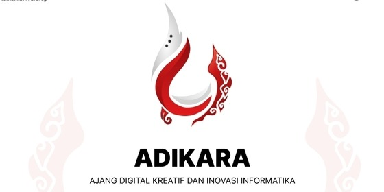
  <br><sub>Gambar: halaman kompetisi <a href="https://www.kaggle.com/competitions/data-mining-adikara">Penyisihan Data Mining Adikara 2024</a> di Kaggle.</sub>
</p>

# Meramal Indeks Harga Pangan 22 Negara Sepuluh Tahun ke Depan
### Penyisihan Data Mining Adikara 2024 · Peramalan deret waktu bulanan dengan horizon 120 bulan

**Jika hanya punya sejarah harga satu negara, seberapa jauh kita bisa meramal sepuluh tahun ke depan, dan apakah negara lain bisa membantu?**

Proyek ini meramal `FoodPriceIndex` bulanan 22 negara untuk Januari 2014 sampai Desember 2023, hanya dari data 1970–2013.
Tidak ada variabel penjelas lain: setiap negara hanya punya satu deret angka. Analisis disusun seperti laporan riset:
setiap keputusan pemodelan berasal dari temuan EDA, dan setiap model dinilai dengan backtest yang meniru situasi
kompetisi, yaitu meramal 10 tahun penuh tanpa melihat masa depan.

**Temuan utama: meramal setiap negara sendiri-sendiri memberi SMAPE backtest 10,30. Menyusutkan laju pertumbuhan tiap
negara 75% ke arah median 22 negara menurunkannya menjadi 6,07, dan ensemble akhir mencapai 5,63, kurang dari setengah
baseline "harga tidak berubah" (12,05).**

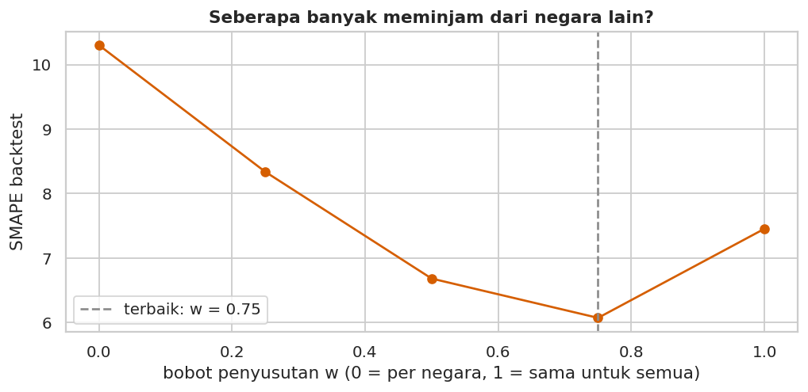

---

## Ruang lingkup

- Eksplorasi data kosong, perjalanan indeks per negara, perubahan laju inflasi antar dekade, pola musiman, dan seberapa
  kuat negara-negara bergerak bersama.
- Desain validasi rolling-origin dengan tiga backtest 10 tahun (origin 1993, 1998, 2003).
- Baseline naif, model per negara (drift dan damped trend Holt, dengan dan tanpa musiman), model gabungan lintas negara,
  dan ensemble.
- Analisis error menurut jarak ramalan dan per negara, serta contoh ramalan yang berhasil dan gagal.

Notebook asli dari masa kompetisi (Desember 2024) hilang. Seluruh analisis di repositori ini disusun ulang dari nol pada
November 2026 dan dijalankan penuh di Kaggle.

## Data dan desain eksperimen

| Data | Isi | Baris |
| --- | --- | ---: |
| `train_adikara2024.csv` | `Country`, `Year`, `Month`, `FoodPriceIndex`, Januari 1970 – Desember 2013 | 11.616 |
| `test_adikara2024_unlabeled.csv` | negara dan bulan yang diramal, Januari 2014 – Desember 2023 | 2.640 |

Metrik kompetisi adalah **SMAPE** (symmetric mean absolute percentage error, makin kecil makin baik). Karena data uji
adalah 10 tahun setelah data latih berakhir, K-Fold acak tidak bisa dipakai. Setiap model dilatih dengan data sampai akhir
1993, 1998, dan 2003, lalu meramal 120 bulan berikutnya. Skor model adalah rata-rata SMAPE ketiga backtest.

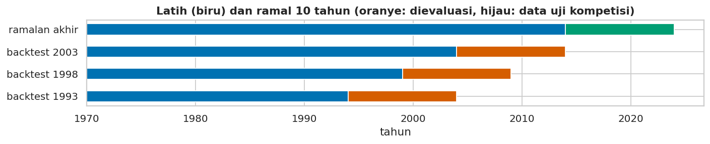

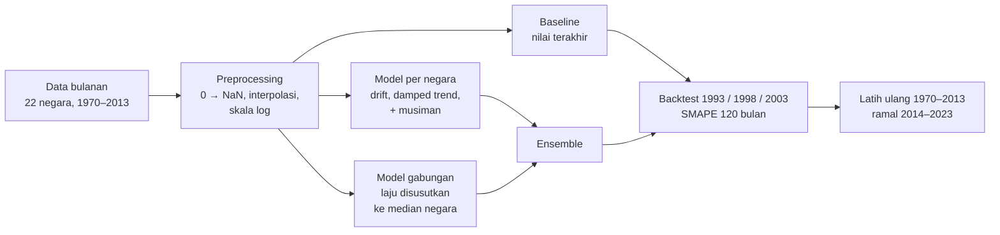

## Cerita dari data

### 1. Nol bukan harga, melainkan seri yang belum dimulai

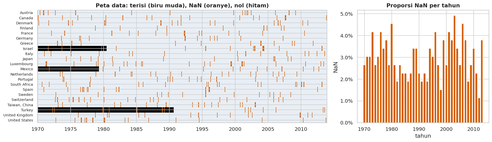

Nilai 0 hanya muncul sebagai blok utuh di awal seri Israel (sampai 1980), Meksiko (sampai 1979), dan Turki (sampai 1990).
NaN, sekitar 3% sel, tersebar acak tanpa pola waktu. Nol dibuang agar tidak dianggap harga, sedangkan NaN diisi
interpolasi untuk melatih tetapi tidak dipakai saat mengevaluasi.

### 2. Inflasi pangan melambat tajam, jadi sejarah panjang menyesatkan

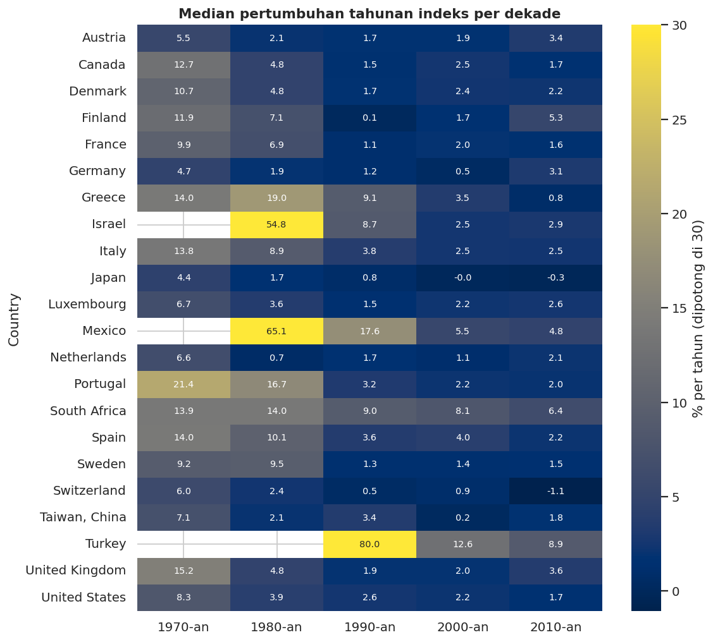

Median kenaikan lintas negara turun dari 9,9% per tahun di 1970-an menjadi 4,8% di 1980-an, lalu sekitar 2% sejak
1990-an. Negara dengan hiperinflasi (Turki, Meksiko, Israel) juga konvergen. Model yang belajar dari 44 tahun penuh akan
meramal kenaikan yang jauh terlalu tinggi, sehingga semua model hanya memakai 3 sampai 15 tahun terakhir.

### 3. Musiman ada, tetapi kecil dibanding tren

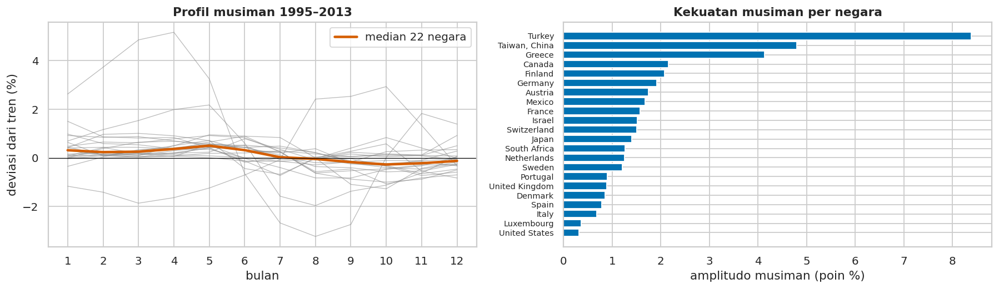

Median profil musiman hanya bergerak sekitar ±0,5%. Amplitudo besar hanya ada di Turki, Taiwan, dan Yunani. Dibanding
tren 2% per tahun yang terakumulasi menjadi sekitar 20% dalam 10 tahun, musiman adalah detail.

### 4. Negara-negara bergerak bersama

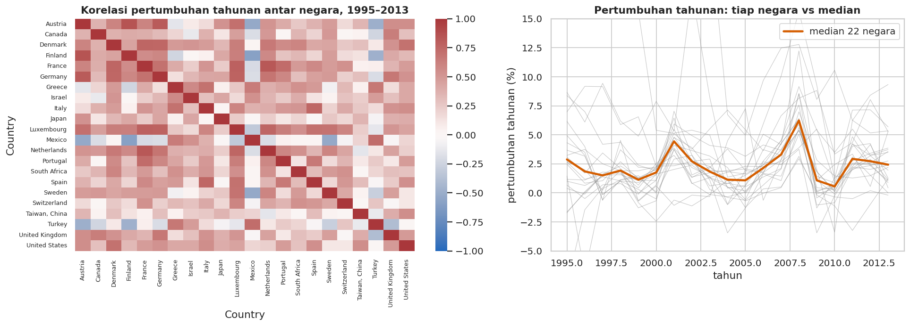

Median korelasi pertumbuhan tahunan antar pasangan negara adalah 0,35, dan median 22 negara jauh lebih stabil daripada seri
satu negara (lonjakan bersama terlihat di krisis pangan 2008). Temuan ini menjadi dasar model gabungan.

## Hasil

### Perbandingan model (SMAPE backtest, makin kecil makin baik)

| Model | 1993 | 1998 | 2003 | Rata-rata |
| --- | ---: | ---: | ---: | ---: |
| Nilai terakhir (baseline) | 11,36 | 12,21 | 12,59 | 12,05 |
| Drift 5 tahun, per negara | 11,94 | 11,12 | 8,01 | 10,35 |
| Damped trend + musiman, per negara | 6,17 | 8,53 | 8,53 | 7,75 |
| Tren gabungan, penyusutan 75% ke median | 7,29 | 4,88 | 6,16 | 6,11 |
| **Ensemble: tren gabungan + damped trend musiman** | **4,69** | **6,16** | **6,04** | **5,63** |

Model gabungan sendiri tidak stabil antar backtest. Ensemble dengan damped trend musiman menutupi kelemahan itu dan
menjadi yang terbaik serta paling konsisten.

### Seberapa banyak meminjam dari negara lain

| Bobot penyusutan $w$ | 0 (per negara) | 0,25 | 0,5 | 0,75 | 1 (sama untuk semua) |
| --- | ---: | ---: | ---: | ---: | ---: |
| SMAPE backtest | 10,30 | 8,34 | 6,68 | **6,07** | 7,45 |

Kurvanya berbentuk U. Meminjam sebagian besar informasi dari negara lain membantu, tetapi memaksakan laju yang sama untuk
semua negara menghapus perbedaan yang nyata.

### Skor kompetisi

| Submission | Public | Private |
| --- | ---: | ---: |
| Notebook ini (late submission, tidak masuk leaderboard resmi) | 3,67 | 10,99 |
| Submission terbaik tim saat kompetisi, Desember 2024 (peringkat 4 dari 23) | 3,27 | **9,86** |
| Peringkat 1 leaderboard private | | 8,93 |

Skor private notebook ini **lebih buruk** dari submission tim saat kompetisi. Selisih public dan private yang besar
terjadi di seluruh leaderboard, sejalan dengan temuan bahwa error membesar di tahun-tahun akhir horizon. Dugaan saya,
bagian private memuat tahun-tahun lonjakan inflasi pangan dunia 2021–2023, ketika model yang meredam tren meramal kenaikan
terlalu landai. Backtest tidak memuat guncangan sebesar itu. Model tidak dituning ulang mengikuti leaderboard, karena itu
sama saja memakai data uji untuk memilih model.

## Interpretasi

### Error tumbuh seiring jarak ramalan

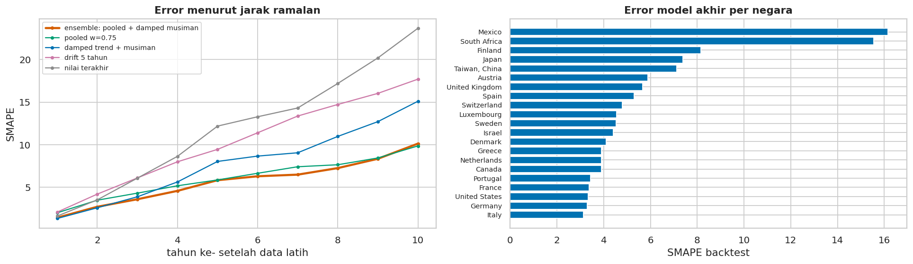

Di tahun pertama semua model setara (SMAPE 1,3 sampai 2,1). Di tahun kesepuluh, baseline mencapai 23,7, sedangkan model
akhir 10,1. Pada horizon panjang, yang menentukan adalah arah dan kemiringan tren, bukan detail musiman. Meksiko dan Afrika
Selatan adalah negara tersulit karena rezim inflasinya berubah di tengah horizon.

### Kapan meminjam informasi justru merugikan

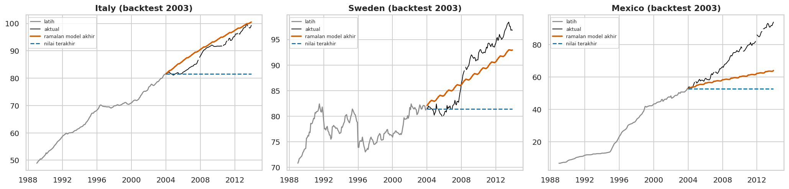

Italia diramal hampir sempurna karena trennya stabil. Swedia melonjak saat krisis 2008, dan model menangkap arahnya tetapi
tidak besarannya. Meksiko adalah kegagalan yang jujur: penyusutan ke median global meredam tren Meksiko yang sebenarnya tetap
tinggi. Informasi yang menolong rata-rata merugikan negara yang benar-benar berbeda.

### Ramalan akhir 2014–2023

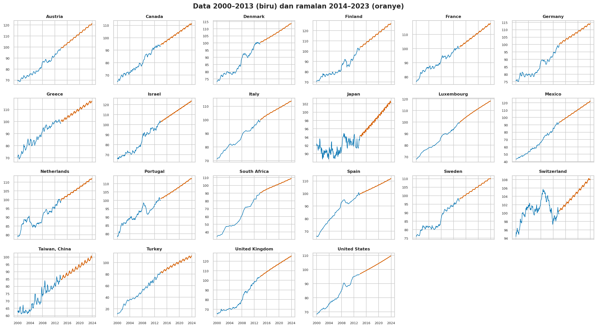

Median kenaikan sepuluh tahun yang diramal sekitar 17% (sekitar 1,6% per tahun), dari 8% di Swiss sampai 38% di Turki.

## Menjalankan

Notebook dijalankan di Kaggle (CPU, sekitar 1 menit).

```bash
pip install -r requirements.txt kaggle
python _build_notebook.py                  # regenerasi notebook + runner dari satu sumber
kaggle kernels push -p kaggle-notebook     # notebook yang tampil di Kaggle
kaggle kernels push -p kaggle              # runner: mengeksekusi notebook dan menyimpan versi ber-output
kaggle kernels output fauzan2/adikara-2024-data-mining-runner -p output/
```

Kernel memakai dataset privat `fauzan2/adikara-2024-data-mining-data` (salinan data kompetisi, karena data kompetisi lama
tidak bisa ditempel langsung lewat API) dan `fauzan2/adikara-2024-data-mining-src` (modul `src/`).

Untuk menjalankan secara lokal, unduh data kompetisi ke `data/raw/`, lalu jalankan notebook dari folder `notebooks/`.

## Peta repositori

| Lokasi | Isi |
| --- | --- |
| `notebooks/adikara-2024-data-mining.ipynb` | Notebook riset lengkap dengan output |
| `src/data/load_data.py` | Pencarian path data, load, panel negara × bulan, pembersihan nol dan NaN |
| `src/models/forecasters.py` | SMAPE, baseline, drift, damped trend, model gabungan, ensemble, backtest rolling-origin |
| `src/visualization/plots.py` | Gaya grafik dan palet ramah buta warna (Okabe–Ito) |
| `reports/figures/` | 10 grafik yang dipakai di notebook dan README |
| `reports/*.csv` | Leaderboard backtest dan SMAPE per tahun horizon |
| `submissions/submission.csv` | Submission akhir |
| `_build_notebook.py`, `_findings.json` | Sumber tunggal notebook dan runner Kaggle, beserta teks temuan |
| `kaggle-notebook/`, `kaggle/` | Metadata kernel notebook dan runner |

## Keterbatasan

Backtest hanya memakai tiga origin, dan Turki tidak ikut dievaluasi karena riwayatnya baru dimulai 1990. Penyusutan ke
median merugikan negara yang benar-benar berbeda (Meksiko, Afrika Selatan, Jepang); bobot per kelompok negara bisa menjadi
langkah lanjut. Guncangan seperti krisis pangan 2008 atau inflasi pascapandemi tidak bisa diramal dari sejarah harga saja,
dan variabel eksternal seperti harga komoditas dunia atau kurs tidak tersedia di kompetisi ini. Skor late submission
diperoleh setelah kompetisi berakhir dan tidak dapat dibandingkan secara setara dengan peserta yang bekerja dalam batas
waktu kompetisi.

## Penulis

**Fauzan Ahsanudin Alfikri** · [Kaggle: fauzan2](https://www.kaggle.com/fauzan2)

Data berasal dari kompetisi [Penyisihan Data Mining Adikara 2024](https://www.kaggle.com/competitions/data-mining-adikara)
dan hanya digunakan untuk keperluan edukasi dan portofolio.
